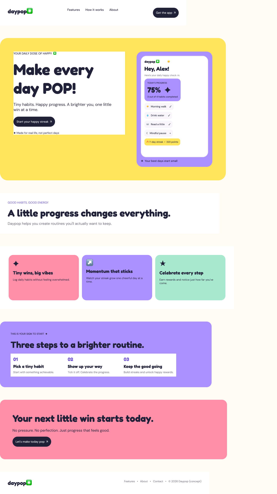
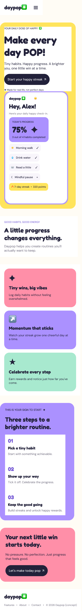
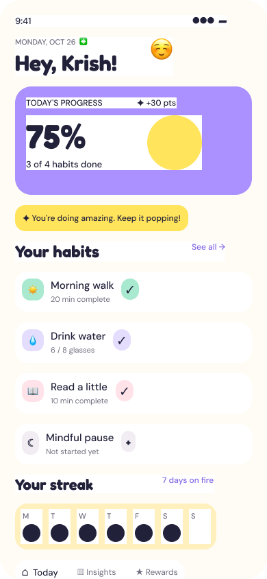
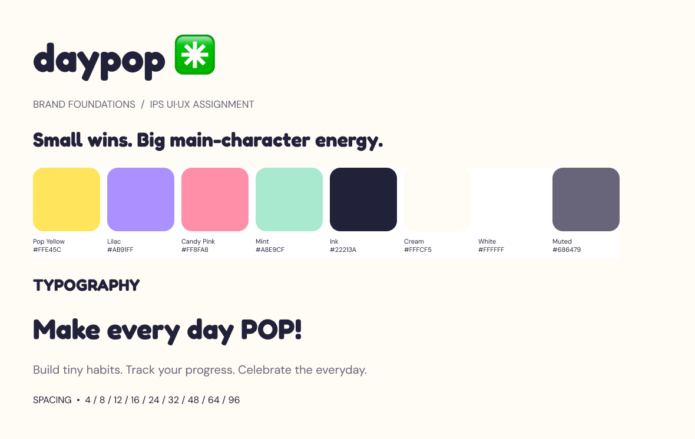
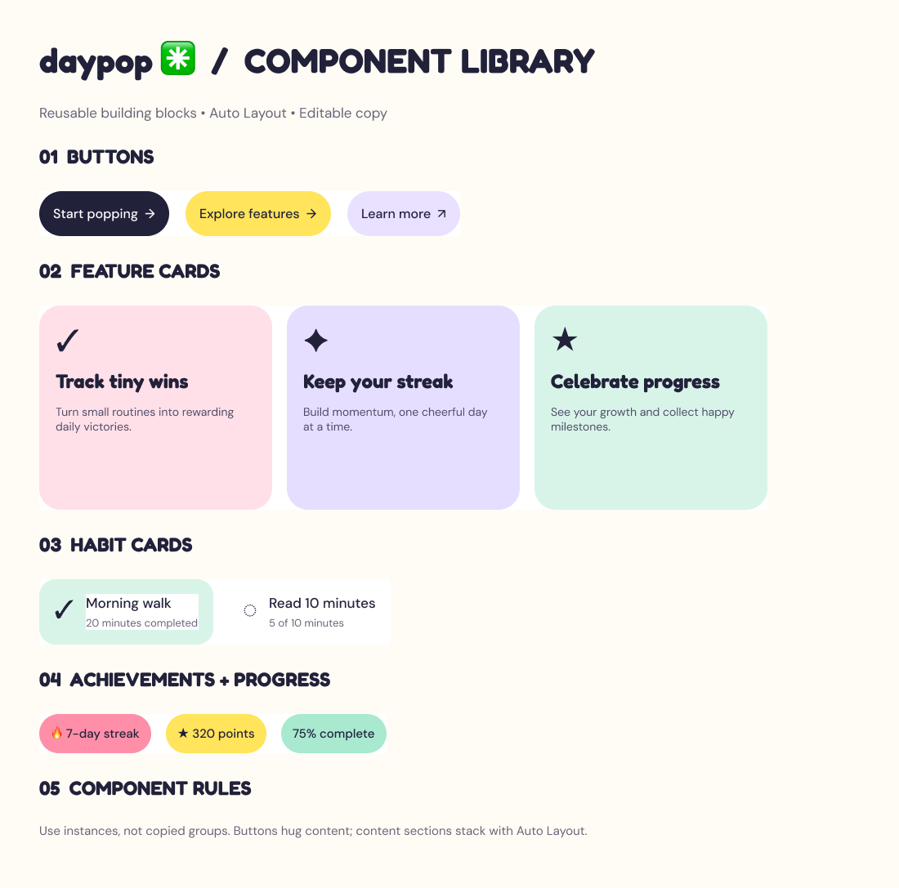

# daypop ✳ | Make Every Day POP!

**A colorful, responsive product landing page designed in Figma for the IPS UI/UX assignment.**

> **Small wins. Big main-character energy.**

Daypop is a fictional habit-tracking application that helps everyday people turn achievable routines into satisfying daily wins. Its landing page communicates optimism through vivid colors, expressive typography, and a realistic, editable app dashboard.

## View the design in Figma

- **[Complete Figma project](https://www.figma.com/design/I3JsNxGBOJpcptFlm6nQQw)**
- [Desktop landing page, 1440 px](https://www.figma.com/design/I3JsNxGBOJpcptFlm6nQQw?node-id=10-2)
- [Mobile landing page, 390 px](https://www.figma.com/design/I3JsNxGBOJpcptFlm6nQQw?node-id=10-78)
- [App dashboard, 390 × 844](https://www.figma.com/design/I3JsNxGBOJpcptFlm6nQQw?node-id=9-2)
- [Foundations / design system](https://www.figma.com/design/I3JsNxGBOJpcptFlm6nQQw?node-id=4-27)
- [Reusable component library](https://www.figma.com/design/I3JsNxGBOJpcptFlm6nQQw?node-id=6-3)

Screenshot gallery: enable after exporting the PNG files
## Screenshots







## The problem

Many habit-building tools feel overwhelming or overly serious. Daypop presents a friendlier alternative: simple actions, visible progress, and small celebrations that help users stay engaged without demanding perfection.

## Target audience

Everyday consumers, especially students and young professionals around ages 16–35, who want a cheerful and accessible way to build routines.

## Key features

1. **Track tiny wins:** Check off daily habits such as walking, drinking water, and reading.
2. **Build momentum:** View daily completion progress and streak indicators.
3. **Celebrate progress:** See points and achievement-style badges.
4. **Friendly dashboard:** Personal greeting, progress summary, habit cards, weekly streak, and bottom navigation.

## Landing-page structure

Both versions include navigation, a hero with an editable product mockup, introductory messaging, three feature cards, a how-it-works section, a final call to action, and a footer.

| Design | Frame width | Arrangement |
|---|---:|---|
| Desktop landing page | 1440 px | Two-column hero, horizontal feature cards |
| Mobile landing page | 390 px | Stacked hero and cards, compact navigation |
| App dashboard | 390 px | Vertical daily overview |

## Figma UI/UX techniques

- Nested **Auto Layout** for sections, headers, buttons, cards, and app interface blocks.
- Reusable **Figma components** for primary, accent, and secondary buttons; three feature-card types; two habit-card states; and three badges (**11 components total**).
- Shared **color variables**, **spacing variables**, and **text styles**.
- Desktop and mobile layouts with adjusted typography, spacing, and content flow.
- Editable text and native shapes. Screens are not merely flattened images.

## Visual design system

| Token | HEX | Purpose |
|---|---|---|
| Pop Yellow | `#FFE45C` | Optimism and high-energy emphasis |
| Lilac | `#AB91FF` | Core dashboard accent |
| Candy Pink | `#FF8FA8` | Playful secondary callouts |
| Mint | `#A8E9CF` | Positive habit completion |
| Ink | `#22213A` | High-contrast headings and text |
| Cream | `#FFFCF5` | Warm landing-page background |

**Typography:** Fredoka Bold (headings) and DM Sans (body and UI). Spacing follows an 8px-oriented scale with supporting 4px increments.

## Design process

1. Define the fictional product, audience, and cheerful brand direction.
2. Build the color/typography foundations in Figma.
3. Create reusable, editable components.
4. Design a realistic daily habit dashboard.
5. Compose desktop and mobile landing-page variants using Auto Layout.
6. Review exported screens and submit the Figma link alongside this repository.

## Project structure

```text
daypop-uiux-landing-page/
├── README.md
├── assets/
│   └── EXPORT_GUIDE.md      # Add exported PNGs here before submission
└── docs/
    └── design-rationale.md
```

## Project scope

This is a **Figma UI/UX design project**, not a coded or functional production application. Buttons and dashboard metrics demonstrate proposed UI states. Daypop, its user profile, and its product claims are fictional. A live website is not included.


